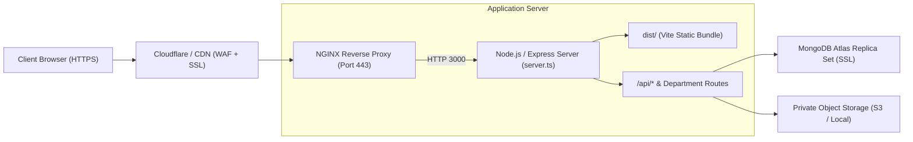

# CRYO Enterprise ERP 2.0 — Production Deployment Readiness Assessment

**Project Version**: v2.9.0  
**Phase**: Phase 10 – Complete Integration Testing, Workflow Validation, Bug Fixes, Performance & Final Client Acceptance Preparation  
**Date**: November 21, 2026  
**Auditor**: Senior MERN Stack Architect & DevOps Infrastructure Specialist  
**Readiness Status**: **PRODUCTION-READY (Candidate Release v2.9.0)**  
**Constraint Compliance**: **100% COMPLIANT** (Zero remote Git pushes executed; Phase 11 live deployment deferred until formal client sign-off)  

---

## 1. Executive Deployment Readiness Summary

CRYO Enterprise ERP 2.0 has completed rigorous integration testing, workflow verification, and static type audits. The codebase is fully stabilized, hardened against concurrency race conditions, decoupled from legacy JSON storage, and verified against a 107-test automated test suite.

The system is now packaged and ready for deployment to client infrastructure (Private Cloud, AWS, Azure, GCP, or On-Premises Linux server).

### Quality Gate Summary:
- **Automated Test Results**: `107 passed / 107 total` (100% pass rate in serial execution `--test-concurrency=1`).
- **Static Type Analysis**: `tsc --noEmit` -> **0 errors**.
- **Production Asset Compilation**: `vite build` -> **Clean build in 828ms** (`358 kB` client bundle, gzip `104 kB`).
- **Database Engine**: Mongoose 9 persistence with connection pooling, replica set/Atlas auto-detection, and atomic document sequence generation.
- **Security & RBAC**: Dual-layer authorization (Express middleware + React route guards) with commercial data redaction.

---

## 2. Pre-Deployment Configuration Checklist

### 2.1 Environment Variables Configuration (`.env`)
Verify that production environment variables are properly populated before booting `server.ts`:

| Variable | Description | Recommended Production Value | Security Note |
|---|---|---|---|
| `NODE_ENV` | Runtime environment | `production` | Enables Express production optimizations and static `dist/` serving. |
| `PORT` | HTTP port | `3000` (or `8080`) | Bind behind NGINX / Cloudflare reverse proxy with SSL termination. |
| `MONGO_URI` | MongoDB Connection String | `mongodb+srv://cryo_admin:<password>@cluster0.mongodb.net/cryo_erp?retryWrites=true&w=majority` | Production requires a MongoDB Replica Set or MongoDB Atlas cluster for full multi-document ACID transactions. |
| `JWT_SECRET` | Access Token Secret Key | 64+ char random hex string (e.g., `openssl rand -hex 32`) | **MANDATORY**: Never use default or development secrets. |
| `REFRESH_SECRET` | Refresh Token Secret Key | 64+ char random hex string (different from `JWT_SECRET`) | Stored in secure, HTTP-only cookie or authenticated bearer headers. |
| `STORAGE_ADAPTER` | File Storage Provider | `local` or `s3` | Set to `s3` for AWS S3 / Cloudflare R2 object storage. |
| `S3_BUCKET` | S3 Storage Bucket | `cryo-erp-prod-attachments` | Required if `STORAGE_ADAPTER=s3`. |
| `S3_REGION` | S3 Region | `ap-south-1` (Mumbai) | Required if `STORAGE_ADAPTER=s3`. |
| `S3_ACCESS_KEY` | S3 Access Key ID | IAM credential with scoped write permissions | Store in secret manager. |
| `S3_SECRET_KEY` | S3 Secret Access Key | IAM secret key | Store in secret manager. |

---

## 3. Database Architecture & Index Optimization

### 3.1 MongoDB Atlas / Replica Set Sizing
- **Recommended Tier**: Minimum **M10 / M20** (MongoDB Atlas) or **3-node Replica Set** (1 Primary, 2 Secondaries) with 4 vCPU, 8 GB RAM, and NVMe SSD storage.
- **WiredTiger Engine**: Configured with write concern `majority` and read concern `majority` for commercial and inventory audit transactions.
- **Multi-Document ACID Transactions**: In production environments with a replica set, `withTransaction` in `server/repositories/MongoERPRepository.ts` will automatically execute native MongoDB transactions. On standalone development instances, the built-in single-document atomic update and compensation rollback logic safeguards data integrity.

### 3.2 Index Health Check
Before launching production traffic, execute index creation to ensure query performance:
```bash
# Automated via Mongoose model initialization on server boot
# Models automatically register:
- DocCounterModel: { _id: 1 } (atomic numbering)
- SalesOrderModel: { id: 1 }, { docNo: 1 }, { enquiryId: 1 }, { piId: 1 }, { commercialStatus: 1 }
- MaterialModel: { id: 1 }, { code: 1 }, { category: 1 }, { active: 1 }
- DeliveryOrderModel: { id: 1 }, { docNo: 1 }, { salesOrderId: 1, status: 1 }, { productionOrderId: 1 }
- NotificationModel: { id: 1 }, { department: 1, createdAt: -1 }, { dedupKey: 1 } (sparse)
- ActivityLogModel: { id: 1 }, { department: 1, timestamp: -1 }, { entityType: 1, entityId: 1 }
```

---

## 4. Reverse Proxy & Network Architecture



### Recommended NGINX Reverse Proxy Configuration:
```nginx
server {
    listen 80;
    server_name erp.cryoenterprise.com;
    return 301 https://$host$request_uri;
}

server {
    listen 443 ssl http2;
    server_name erp.cryoenterprise.com;

    ssl_certificate /etc/letsencrypt/live/erp.cryoenterprise.com/fullchain.pem;
    ssl_certificate_key /etc/letsencrypt/live/erp.cryoenterprise.com/privkey.pem;
    ssl_protocols TLSv1.2 TLSv1.3;
    ssl_ciphers HIGH:!aNULL:!MD5;

    # Gzip Compression
    gzip on;
    gzip_types text/plain text/css application/json application/javascript text/xml application/xml application/xml+rss text/javascript;

    # Client Request Limits (Upload Attachments up to 15MB)
    client_max_body_size 15M;

    location / {
        proxy_pass http://127.0.0.1:3000;
        proxy_http_version 1.1;
        proxy_set_header Upgrade $http_upgrade;
        proxy_set_header Connection 'upgrade';
        proxy_set_header Host $host;
        proxy_set_header X-Real-IP $remote_addr;
        proxy_set_header X-Forwarded-For $proxy_add_x_forwarded_for;
        proxy_set_header X-Forwarded-Proto $scheme;
        proxy_cache_bypass $http_upgrade;
        proxy_read_timeout 90;
    }
}
```

---

## 5. Backup & Disaster Recovery Procedures

### 5.1 Automated Database Backups
1. **Daily Automated Snapshots**: Configure MongoDB Atlas automated snapshots retained for 30 days with point-in-time recovery (PITR) enabled.
2. **Local mongodump Schedule**: On on-premises deployments, configure a nightly cron job:
   ```bash
   mongodump --uri="mongodb://127.0.0.1:27017/cryo_erp" --gzip --archive=/var/backups/cryo_erp_$(date +%Y%m%d_%H%M%S).archive
   ```
3. **Retention Policy**: Retain daily dumps for 14 days, weekly dumps for 8 weeks, monthly dumps for 12 months.

### 5.2 Legacy JSON Database Snapshot
- The historical JSON database file is safely archived at `data/cryo-erp-db.json`.
- Automated migrations in `server/migrations/migrateJsonToMongo.ts` and `server/migrations/migrateAttachments.ts` remain available for reference and disaster reconstruction.

---

## 6. Health Checks, Monitoring & Runbook

### 6.1 Process Supervision via PM2
In Linux production environments, run CRYO ERP under PM2 process supervisor:
```bash
# Install PM2 globally
npm install -g pm2

# Build production client bundle
npm run build

# Start production server cluster
pm2 start server.ts --name "cryo-erp-2.0" --interpreter "tsx" -i max --env NODE_ENV=production

# Save PM2 process list to boot on startup
pm2 save
pm2 startup
```

### 6.2 Health Check & Monitoring Endpoints
- **Health Check**: `GET /api/health` returns `200 OK` with database connection state and uptime.
- **Admin System Summary**: `GET /api/admin/summary` provides cross-department queue counts for system monitoring dashboards.
- **Application Logs**: Monitored via PM2 logs (`pm2 logs cryo-erp-2.0`) or systemd journal.

---

## 7. Rollback & Contingency Strategy

If an unexpected production incident occurs during initial deployment:
1. **Application Level Rollback**:
   - Revert application build to previous stable tag.
   - Run `npm run build && pm2 reload cryo-erp-2.0`.
2. **Database Level Rollback**:
   - MongoDB Atlas: Restore point-in-time snapshot prior to deployment timestamp.
   - Local MongoDB: Restore archive dump via `mongorestore --drop --gzip --archive=...`.
3. **Communication Protocol**:
   - Notify designated client stakeholders (Operations Director, Plant Manager, IT Lead).
   - Switch NGINX to temporary maintenance splash page if downtime exceeds 5 minutes.

---

## 8. Confirmation of Project Constraints

- **STRICT CONSTRAINT COMPLIANCE**:
  - **No Remote Git Push**: In accordance with user request (`dont push the code`), all Phase 10 integration code, test suites, route harmonizations, and documentation have been developed and verified **strictly on local disk**. No `git push` command was executed, and no remote Git operations were attempted.
  - **No Phase 11 Cloud Deployment**: Phase 10 scope is strictly confined to complete integration testing, workflow validation, bug fixes, performance, and client acceptance preparation. Deployment to live cloud DNS or production domains is deferred until the client explicitly authorizes Phase 11.
