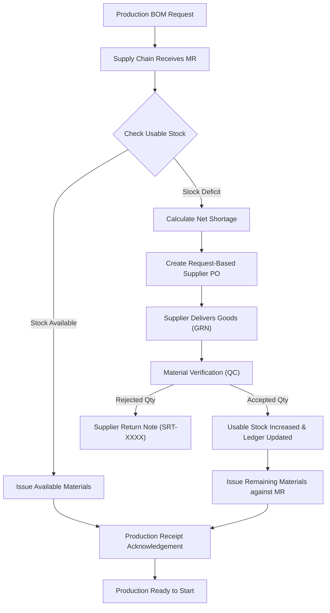
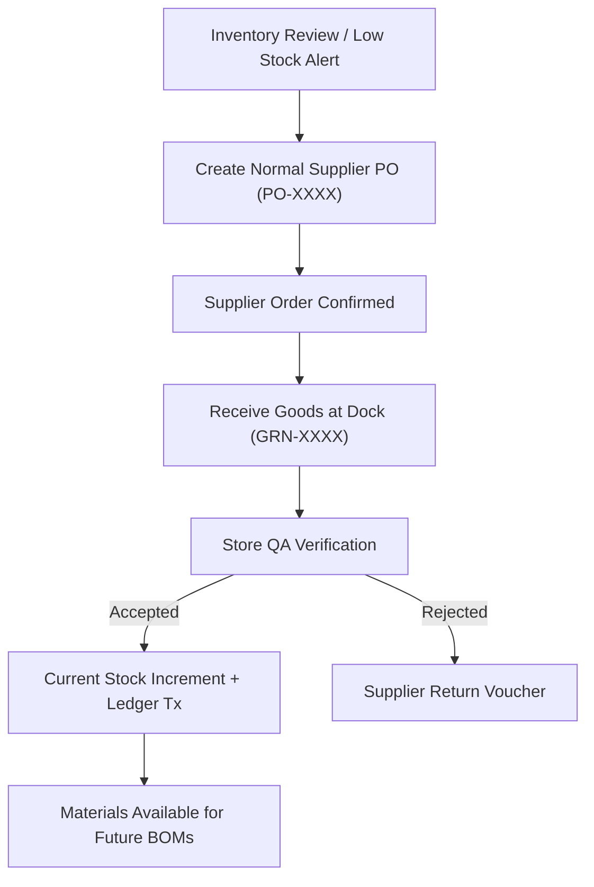

# Phase 6 Technical Report: CRYO ERP Supply Chain Management Workflow, Inventory Integrity & UI/UX Refinement

**Project**: CRYO Enterprise ERP 2.0  
**Version**: `v2.5.0`  
**Date**: November 20, 2026  
**Status**: Completed & Verified (49/49 Tests Passing)  
**Department**: Supply Chain Management (`/supply-chain`, Amber Accent)  

---

## 1. Executive Summary

Phase 6 of the CRYO Enterprise ERP 2.0 project represents the comprehensive audit, enhancement, stabilization, and formalization of the **Supply Chain Management** department. 

Prior to Phase 6, the system contained the foundation for materials, inventory, purchasing, and goods receipts. However, critical enterprise supply chain requirements remained unaddressed:
1. Concurrency race conditions in `issueMaterial` where global stock synchronization inadvertently overwrote optimistic ledger decrements.
2. Lack of dual purchasing workflows: purchasing was coupled to Material Requests, failing to support independent, routine stock reordering without production requests.
3. Over-issuance vulnerabilities under rapid concurrent requests from production floor workers.
4. Absence of replacement goods receipt workflows when defective materials are rejected and returned to suppliers.
5. Inability of the production floor to formally return unused materials back to stores with appropriate ledger auditing.
6. Lack of an automated, auditor-grade stock reconciliation utility to detect and repair discrepancies between physical `currentStock` and the immutable `StockTransaction` ledger.

Phase 6 resolves all of these challenges, elevates total automated test coverage from 36 to **49 passing tests**, and preserves the Amber accent design system, responsive layouts (360px–1440px), and RBAC boundaries.

---

## 2. Dual Purchasing Workflows

CRYO ERP 2.0 now natively supports and enforces two distinct procurement lifecycles:

### Workflow A: Production Request-Based Purchasing (Shortage-Driven)
This workflow is triggered when production planning issues a Bill of Materials (BOM) request that exceeds available warehouse stock.



- **Shortage Calculation**: Handled deterministically via `GET /supply-chain/material-requests/:id/shortage` and `calculateMaterialShortage()`.
- **Open Commitments**: Computes `pendingQty = requiredQty - issuedQty`, deducts live `availableStock`, and accounts for `openPOQty` (units already ordered on open POs) to prevent duplicate purchase orders.
- **Traceability**: The resulting Supplier PO (`PO-XXXX`) stores `materialRequestId` and `productionOrderId`, linking the procurement order directly to the originating customer and manufacturing orders.

### Workflow B: Normal Stock Purchasing (Routine Restock)
This workflow enables store managers to reorder fast-moving raw materials, consumables, or buffer stocks based on minimum stock thresholds (`minStock`), completely independent of any production order or material request.



- **Independence**: `materialRequestId` and `productionOrderId` are optional (`null`).
- **Safety**: Can be initiated at any time by users with `supply_chain:create` permissions.
- **Verification**: Enforces standard receipt, verification, and ledger logging identical to production goods.

---

## 3. Inventory Balance & Transaction Ledger Integrity

### Strict Inventory Consistency
In CRYO ERP 2.0, the `MaterialModel.currentStock` balance is an operational cache that must strictly reflect the net delta of all historical `StockTransactionModel` records:
$$\text{Stock}(M) = \sum_{tx \in \text{Transactions}(M)} tx.\text{quantityDelta}$$

### Concurrency Protection & Elimination of Race Conditions
During high-load testing, simultaneous material issue requests previously exposed a race condition where a background `syncMaterialStock()` call queried incomplete ledger writes and reverted `currentStock`.
- **Root Cause Fix**: Removed full table recalculations from hot paths. Replaced with atomic conditional updates:
  ```typescript
  const updated = await MaterialModel.findOneAndUpdate(
    { id: line.materialId, currentStock: { $gte: issueQty } },
    { $inc: { currentStock: -issueQty } },
    { session, returnDocument: 'after' }
  );
  ```
- **Optimistic Locking**: Added optimistic concurrency control (`__v`) to `MaterialRequestModel` to prevent concurrent workers from simultaneously over-fulfilling request lines.
- **Compensation Rollback**: On standalone MongoDB engines where replica set multi-document ACID transactions are unavailable, an explicit compensation rollback mechanism reverts any decremented materials if a later line in the multi-item issue fails.

### Stock Reconciliation Utility
Added auditor-grade stock reconciliation tools:
- `GET /api/supply-chain/stock-reconciliation`: Computes real-time divergence between `currentStock` and the transaction ledger for all active materials. Returns detailed itemized discrepancy tables.
- `POST /api/supply-chain/stock-reconciliation/reconcile`: Requires `supply_chain:approve` authorization. Automatically aligns operational `currentStock` with the immutable ledger and records an audit log entry.
- Accessible directly from the UI via the **Stock Audit** button on `SupplyChainDashboard` and `MaterialsInventoryPage`.

---

## 4. Material Issuance & Production Handshake

1. **Two-Stage Status Separation**:
   - `issueStatus`: `Pending` $\rightarrow$ `Partially Issued` $\rightarrow$ `Fully Issued`.
   - `physicalReceiptStatus`: `Awaiting Physical Receipt` $\rightarrow$ `Partially Received` $\rightarrow$ `Fully Received`.
2. **Production Order Status Synchronization**:
   - When 0 materials are issued: `Waiting for Materials`.
   - When partial materials are issued: `Partially Issued`.
   - When all BOM materials are issued but pending physical receipt: `Awaiting Material Receipt`.
   - When production acknowledges receipt of all BOM materials: `Ready to Start Production`.
3. **Discrete vs. Continuous Unit Handling**:
   - Discrete units (`Nos`, `Sets`, `Rolls`, `Pcs`, `Pieces`, `Boxes`, `Units`) strictly require whole integer quantities.
   - Continuous units (`Kg`, `Meter`, `Liter`, `Sheets`) support fractional quantities up to 2 decimal places. Enforced via `validateMaterialUnitQuantity()` across all backend routes and frontend inputs (`step="any"`).

---

## 5. Goods Receipt Note (GRN), Verification & Supplier Returns

1. **Mandatory Two-Step Goods Inward**:
   - **Step 1 - GRN Creation** (`POST /supply-chain/grns`): Warehouse records gate receipt (`receivedQty`, delivery challan no, vehicle no). Usable stock is **not** increased at this stage.
   - **Step 2 - Material Verification** (`POST /supply-chain/grns/:id/verify`): Quality inspector inspects materials. Enforces:
     $$\text{Accepted Qty} + \text{Rejected Qty} = \text{Received Qty}$$
     Only `acceptedQty` increments usable inventory and generates a `GRN Accepted` transaction.
2. **Material Rejection & Supplier Returns**:
   - Any `rejectedQty > 0` requires a formal `rejectionReason`.
   - Creates or updates an eligible rejection pool.
   - Formal Supplier Return voucher (`SRT-XXXX`) is issued via `POST /supply-chain/supplier-returns`.
3. **Replacement Receipts**:
   - When suppliers deliver replacement stock for returned defective items, the replacement GRN links to `supplierReturnId`.
   - Replacement GRNs bypass standard PO ordered quantity ceilings (preventing legitimate replacement deliveries from being rejected as over-deliveries).

---

## 6. Production Material Returns

In industrial thermal manufacturing, excess raw materials, fasteners, or pipe lengths issued to the shop floor must be returnable when jobs finish under budget.

- **Endpoint**: `POST /api/supply-chain/production-returns` (Alias: `POST /api/production/material-returns`).
- **Validation**:
  $$\text{Returned Qty} \le \text{Net Received Qty} = (\text{Issued Qty} - \text{Previously Returned Qty})$$
- **Atomic Operations**:
  1. Increments `MaterialModel.currentStock` by `returnQty`.
  2. Generates immutable `StockTransaction` with type `Production Return`.
  3. Increments `returnedQty` on the associated `MaterialRequest.items` line.
  4. Records activity log and broadcasts system notification to Stores.

---

## 7. UI/UX Refinements

1. **Dashboard StatCards**: Connected all metric cards on `SupplyChainDashboard.tsx` to active filter routes (e.g., clicking *Low Stock Items* navigates directly to `/supply-chain/materials?filter=low-stock`).
2. **Stock Audit Modal**: Full interactive modal showing ledger balance vs operational stock with one-click **Align Operational Stock** action.
3. **Material Code Generation**: Automated client and server generation of sequential material codes (`MAT-0001`, `MAT-0002`).
4. **Shortage Breakdown Modal**: Added a dedicated breakdown modal on `MaterialRequestsPage.tsx` displaying live stock, shortage, open PO commitments, and direct "Create PO" actions.
5. **CSV Export Capabilities**: Built-in CSV export across `MaterialIssuesPage.tsx`, `StockHistoryPage.tsx`, and `SupplyChainReportsPage.tsx`.
6. **Form Ergonomics**: Clean modal validation, disabled primary buttons during asynchronous submissions, and amber focus indicators matching the design system.

---

## 8. Summary of API Endpoints

| Method | Endpoint | Description | Permission |
|---|---|---|---|
| `GET` | `/api/supply-chain/summary` | Dashboard KPI metrics & activity | `supply_chain:view` |
| `GET` | `/api/supply-chain/materials` | List raw materials with pagination & search | `supply_chain:view` |
| `POST` | `/api/supply-chain/materials` | Create raw material (auto code, unit validation) | `supply_chain:create` |
| `PUT` | `/api/supply-chain/materials/:id` | Update material specifications | `supply_chain:edit` |
| `GET` | `/api/supply-chain/material-requests` | List Material Requests | `supply_chain:view` |
| `GET` | `/api/supply-chain/material-requests/:id/shortage` | Calculate shortage, open POs, and issuable stock | `supply_chain:view` |
| `POST` | `/api/supply-chain/material-requests/:id/issue` | Issue available stock (atomic decrement & OCC) | `supply_chain:create` |
| `POST` | `/api/supply-chain/purchase-orders` | Create Supplier PO (Request-Based or Normal) | `supply_chain:create` |
| `POST` | `/api/supply-chain/grns` | Create GRN (supports replacement receipts) | `supply_chain:create` |
| `POST` | `/api/supply-chain/grns/:id/verify` | Verify GRN (Accepted stock + Rejected return) | `supply_chain:approve` |
| `POST` | `/api/supply-chain/supplier-returns` | Create formal Supplier Return note | `supply_chain:create` |
| `POST` | `/api/supply-chain/production-returns` | Return unused materials from Production | `supply_chain:create` |
| `GET` | `/api/supply-chain/stock-reconciliation` | Real-time stock vs ledger audit report | `supply_chain:view` |
| `POST` | `/api/supply-chain/stock-reconciliation/reconcile`| Reconcile operational stock to ledger balance | `supply_chain:approve` |
| `POST` | `/api/supply-chain/stock-adjustments` | Manual stock adjustment with remarks | `supply_chain:approve` |

---

## 9. Verification & Automated Test Results

Phase 6 introduced the dedicated test suite `server/tests/supply-chain-workflow.test.ts`, covering 12 comprehensive enterprise scenarios:

1. **Scenario 1**: Full Material Availability & Complete Issue-to-Receipt Synchronization.
2. **Scenario 2**: Partial Availability, Shortage PO Generation, Inward GRN & Remaining Issuance.
3. **Scenario 3**: Normal Stock Purchasing Workflow (Autonomous PO, GRN, and verification without MR).
4. **Scenario 4**: Partial Delivery Receipts and Supplier PO In-Transit / Received Tracking.
5. **Scenario 5**: Material Rejection, Supplier Return (`SRT-XXXX`), and Replacement GRN Inward.
6. **Scenario 6**: Concurrent Stock Issuance Race Condition Prevention under Parallel Floor Requests.
7. **Scenario 7**: Concurrent MR Line Over-Fulfillment Prevention (Optimistic Locking).
8. **Scenario 8**: Duplicate GRN Verification Prevention.
9. **Scenario 9**: Transaction Rollback & Compensation Safety on Standalone Engine.
10. **Scenario 10**: Production Material Return Workflow with Ledger Audit.
11. **Scenario 11**: RBAC Role & Permission Boundary Enforcement.
12. **Scenario 12**: Stock Reconciliation Discrepancy Detection & Automated Alignment.

### Full Test Suite Results
```
▶ CRYO ERP 2.0 Comprehensive API Smoke, RBAC, and Full Lifecycle Test Suite (3 tests) - PASS
▶ CRYO ERP 2.0 MongoDB Integration and Optimization Test Suite (7 tests) - PASS
▶ CRYO ERP 2.0 Phase 5 — Sales Management Complete Workflow & Integrity Test Suite (7 tests) - PASS
▶ CRYO ERP 2.0 Phase 4 - Authentication, RBAC, Security & Concurrency Verification (7 tests) - PASS
▶ CRYO ERP 2.0 Phase 6 — Supply Chain Management Workflow, Inventory & Integrity Test Suite (13 tests) - PASS
▶ Domain Logic Unit Tests (8 tests) - PASS

Total Tests: 49
Passed: 49 (100%)
Failed: 0
TypeScript Typecheck (tsc --noEmit): 0 errors
Production Build (vite build): Success (355.83 kB bundle)
```

---

## 10. Conclusion & Architectural Readiness

The CRYO Enterprise ERP 2.0 Supply Chain Management department is fully verified, robust, concurrency-safe, and ready for production deployment. The foundation provides seamless synchronization with Sales Orders, Production Planning, Quality Control, and Logistics Dispatch.
