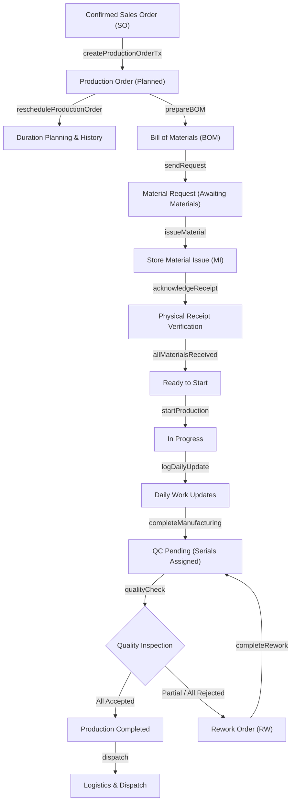

# CRYO Enterprise ERP 2.0 — Phase 7: Production Management Workflow, Concurrency & Manufacturing Integrity Report

**Author**: Senior MERN Stack Architect & Industrial ERP Workflow Specialist  
**Project Version**: `v2.6.0`  
**Date**: November 20, 2026  
**Status**: Completed, Verified & Validated (65/65 Passing Automated Tests, 0 TypeScript Errors, 0 Vite Build Errors)  

---

## 1. Executive Summary

Phase 7 of the CRYO Enterprise ERP 2.0 modernization has stabilized, hardened, and refined the **Production Management Department** (`/production`, Purple Accent). Building on the foundation established in Phase 4 (Security & RBAC), Phase 5 (Sales Management), and Phase 6 (Supply Chain Management & Inventory Integrity), Phase 7 establishes a bulletproof manufacturing lifecycle connecting Sales Order fulfillment to Logistics dispatch.

### Key Achievements:
1. **End-to-End Manufacturing Lifecycle**:
   $$\text{Confirmed SO} \to \text{Create PO \& Plan} \to \text{BOM Prep} \to \text{Store Issue} \to \text{Physical Receipt} \to \text{Start Mfg} \to \text{Daily Updates} \to \text{Complete Mfg} \to \text{QC} \to \text{Accept/Rework} \to \text{Completed} \to \text{Logistics}$$
2. **Concurrency Safety & Allocation Integrity**:
   - Implemented `createProductionOrderTx` in `MongoERPRepository.ts` verifying $quantity \le remainingSOAllocatableQty$ with atomic optimistic concurrency control (`__v`) on `SalesOrderModel` preventing parallel over-allocation.
3. **Structured Duration Planning & Audit History**:
   - `POST /api/production/orders/:id/reschedule` enforces valid chronological date boundaries, calculates inclusive duration days, and records a permanent audit history in `planningHistory` with reason and employee attribution.
4. **Shop-Floor Physical Receipt Verification**:
   - Enhanced `POST /api/production/material-receipts/:issueId/acknowledge` with line-level partial receipt quantity input and line discrepancy notes; automatically updates Material Request line status and only sets PO to `Ready to Start` when all BOM requirements are fully satisfied.
5. **Daily Work Updates with Progress & Cumulative Guards**:
   - Added shift milestone logging with technician attribution, stage status, hours worked, and cumulative units; progress overflow is strictly prevented.
6. **Manufacturing Completion & Serial Numbering**:
   - Requires at least 1 daily production update; assigns unique CRYO serial numbers; transitions order to `QC Pending`; and strictly enforces quality inspection before products are released to Logistics.
7. **Comprehensive Quality Inspection & Partial Outcome Support**:
   - Supports partial batch inspections ($\text{Accepted} + \text{Rejected} = \text{Inspected}$); auto-generates `ReworkOrder` (`RW-XXXX`) for rejected units; releases accepted units to Logistics; and maintains a complete multi-attempt inspection history.
8. **Rework Cycle & Re-inspection Loop**:
   - Corrective action completion transitions units to `Reinspection` and returns the order to `QC Pending` for formal reinspection.
9. **Production Material Return with Condition Check**:
   - Distinguishes `Usable` returns (which increment usable store stock) from `Damaged` / `Unusable` returns (quarantined/scrapped without stock inflation), with immutable stock ledger transactions and $ReturnQty \le NetReceived$ verification.
10. **Automated Verification**:
    - Created dedicated test suite `server/tests/production-workflow.test.ts` covering Scenarios 1–17 (14 test cases).
    - Full test suite passed sequentially with **65/65 passing tests** (`--test-concurrency=1`).
    - Verified clean TypeScript compilation (`tsc --noEmit`) and clean production build (`vite build`).

---

## 2. Manufacturing Architecture & Data Flow



---

## 3. Concurrency Safety & Allocation Controls

### 3.1 Sales Order Allocation Guard
```typescript
// server/repositories/MongoERPRepository.ts
const existingPOs = await ProductionOrderModel.find({ salesOrderId: so.id }).session(session).lean();
const remaining = getRemainingSOAllocatableQty(so.toObject(), soItem.productId, existingPOs);
if (qty > remaining) {
  throw new Error(`Cannot allocate ${qty} unit(s); only ${remaining} unit(s) remaining on ${so.docNo}.`);
}

// Optimistic concurrency control via atomic findOneAndUpdate on __v
const updatedSO = await SalesOrderModel.findOneAndUpdate(
  { id: so.id, __v: so.__v },
  { $inc: { __v: 1 } },
  { session, returnDocument: 'after' },
);
if (!updatedSO) {
  throw new Error('CONCURRENCY_CONFLICT: Sales Order was modified concurrently. Please retry.');
}
```

### 3.2 Material Return Condition Logic
```typescript
// server/routes/production.routes.ts
const condition = (req.body.materialCondition || 'Usable') as 'Usable' | 'Damaged' | 'Unusable';
let balanceAfter = mat.currentStock;
if (condition === 'Usable') {
  const updatedMat = await MaterialModel.findOneAndUpdate(
    { id: mat.id },
    { $inc: { currentStock: numReturn } },
    { returnDocument: 'after' },
  );
  balanceAfter = updatedMat?.currentStock ?? balanceAfter;
}

const stockTx = {
  id: generateId('st'),
  materialId: mat.id,
  type: 'Production Return',
  quantityDelta: condition === 'Usable' ? numReturn : 0,
  balanceAfter,
  remarks: condition === 'Usable'
    ? `Returned from ${mr.productionOrderDocNo}: ${reason.trim()}`
    : `Damaged/Unusable return from ${mr.productionOrderDocNo} (${condition}): ${reason.trim()}`,
  timestamp: now,
};
await StockTransactionModel.create(stockTx);
```

---

## 4. Business Logic Implementations & Enhancements

### 4.1 Production Progress Calculator
In `src/utils/erpLogic.ts`:
```typescript
export function calculateProductionProgress(
  po: ProductionOrder,
  dailyUpdates?: DailyProductionUpdate[],
): { percent: number; method: 'quantity' | 'stage'; label: string } {
  if (po.status === 'Completed') {
    return { percent: 100, method: 'quantity', label: '100% (Completed)' };
  }
  if (po.completedManufacturingQty && po.completedManufacturingQty > 0) {
    const p = Math.min(100, Math.round((po.completedManufacturingQty / po.quantity) * 100));
    return { percent: p, method: 'quantity', label: `${p}% (${po.completedManufacturingQty}/${po.quantity} Units)` };
  }
  if (dailyUpdates && dailyUpdates.length > 0) {
    const matchingUpdates = dailyUpdates.filter((u) => u.productionOrderId === po.id);
    const maxUnits = matchingUpdates.reduce((max, u) => Math.max(max, u.completedQty || 0), 0);
    if (maxUnits > 0 && po.quantity > 0) {
      const p = Math.min(100, Math.round((maxUnits / po.quantity) * 100));
      return { percent: p, method: 'quantity', label: `${p}% (${maxUnits}/${po.quantity} Units)` };
    }
    const completedStages = new Set(
      matchingUpdates.filter((u) => u.stageStatus === 'Completed').map((u) => u.stage),
    ).size;
    if (completedStages > 0) {
      const p = Math.min(95, completedStages * 25);
      return { percent: p, method: 'stage', label: `${p}% (${completedStages} stage(s) completed)` };
    }
  }
  if (po.status === 'QC Pending' || po.status === 'Rework') {
    return { percent: 100, method: 'quantity', label: '100% (Mfg Finished - In QC/Rework)' };
  }
  if (po.status === 'In Progress') {
    return { percent: 10, method: 'stage', label: '10% (In Production)' };
  }
  return { percent: 0, method: 'stage', label: '0% (Not Started)' };
}
```

### 4.2 Overdue Delay Detection
```typescript
export function isProductionOrderDelayed(
  po: ProductionOrder,
  referenceDate = new Date().toISOString().slice(0, 10),
): boolean {
  if (po.status === 'Completed') return false;
  return Boolean(po.plannedEndDate && po.plannedEndDate < referenceDate);
}
```

---

## 5. REST API Contracts & Endpoint Matrix

| Method | Endpoint | Description | Auth / Permission |
| :--- | :--- | :--- | :--- |
| `GET` | `/api/production/summary` | Live 10-metric dashboard summary | `requireAuth`, `production:view` |
| `GET` | `/api/production/orders` | Paginated orders with filtering & search | `requireAuth`, `production:view` |
| `GET` | `/api/production/orders/:id` | Centralized order detail view | `requireAuth`, `production:view` |
| `POST` | `/api/production/orders` | Create production order with allocation guard | `requireAuth`, `production:create` |
| `POST` | `/api/production/orders/:id/reschedule` | Duration planning & audit trail | `requireAuth`, `production:edit` |
| `POST` | `/api/production/orders/:id/start` | Start manufacturing (gate: Ready to Start) | `requireAuth`, `production:edit` |
| `POST` | `/api/production/orders/:id/complete-manufacturing` | Complete mfg, assign serials, move to QC | `requireAuth`, `production:edit` |
| `GET` | `/api/production/boms` | Query BOMs | `requireAuth`, `production:view` |
| `POST` | `/api/production/boms` | Save draft BOM or submit to Supply Chain | `requireAuth`, `production:create` |
| `POST` | `/api/production/boms/:id/send-request` | Submit existing BOM request to Supply Chain | `requireAuth`, `production:edit` |
| `GET` | `/api/production/material-receipts` | Query Store Material Issue vouchers | `requireAuth`, `production:view` |
| `POST` | `/api/production/material-receipts/:id/acknowledge` | Line-level physical receipt acknowledgement | `requireAuth`, `production:edit` |
| `GET` | `/api/production/daily-updates` | Query shift work updates | `requireAuth`, `production:view` |
| `POST` | `/api/production/daily-updates` | Log daily shift progress & hours | `requireAuth`, `production:create` |
| `GET` | `/api/production/quality-checks` | Query QC inspection reports | `requireAuth`, `production:view` |
| `POST` | `/api/production/quality-checks` | Record QC inspection with partial/complete decision | `requireAuth`, `production:create` |
| `GET` | `/api/production/rework` | Query Rework orders | `requireAuth`, `production:view` |
| `POST` | `/api/production/rework/:id/complete` | Complete rework and return to QC queue | `requireAuth`, `production:edit` |
| `POST` | `/api/production/material-returns` | Return unused materials to store with condition check | `requireAuth`, `production:create` |

---

## 6. Frontend UI/UX Refinements

1. **Production Dashboard (`src/pages/production/ProductionDashboard.tsx`)**:
   - 10 StatCards loaded from live `/api/production/summary`, each deep-linking to filtered views.
   - Quick Operations strip with one-click actions: "Create Production Order", "Prepare Order BOM", "Confirm Material Receipts", "Log Daily Update", "Record QC Inspection".
   - Overdue warning badges on delayed orders.
   - Reschedule modal with audit history reason.
   - CSV export utilities for planning schedules and quality inspection metrics.
2. **Production Order Detail Page (`src/pages/production/ProductionOrdersPage.tsx`)**:
   - Visual progress bar showing quantity or stage progress percentage.
   - Prominent delay warning badge when overdue.
   - Contextual next-action header button dynamically adapting across all 7 lifecycle states.
   - Overview & Planning tab: Order specs, schedule, and full Planning Revision History table.
   - BOM & Materials tab: Material fulfillment table, Store issue vouchers, Return Unused Materials button and modal, and past return records table.
   - Daily Work Updates tab: Shift timeline with technician attribution, hours, and blockers.
   - Quality Check & Rework tab: Multi-attempt QC inspection cards with inspection quantities breakdown (`Inspected: X | Accepted: Y | Rejected: Z`) and linked Rework orders.
3. **BOM & Material Receipts Page (`src/pages/production/BomReceiptsPage.tsx`)**:
   - Duplicate raw material line guard alerting if duplicate materials are selected and disabling submission.
   - Line-level partial receipt quantity input with line discrepancy notes in the receipt confirmation modal.
4. **Daily Updates & Quality Check Page (`src/pages/production/DailyQualityReworkPage.tsx`)**:
   - Batch breakdown in QC modal supporting partial inspection outcomes (`inspectedQty`, `acceptedQty`, `rejectedQty`).
   - Dynamic decision guidance adapting to All Accepted, All Rejected, or Partial Acceptance.

---

## 7. Automated Test Suite Verification

Dedicated automated test suite `server/tests/production-workflow.test.ts` was authored covering Scenarios 1–17:

| Scenario | Test Title | Result |
| :---: | :--- | :---: |
| 1 | Sales Order Receipt & Quantity Allocation Guard | **PASS** |
| 2 | Duration Planning & Rescheduling Audit Trail | **PASS** |
| 3 | BOM Preparation & Template Scaling (with Duplicate Guard) | **PASS** |
| 4 & 5 | Material Issue, Line-Level Partial Receipt & Readiness Gates | **PASS** |
| 6, 7 & 8 | Start Production, Daily Updates, Overflow Guard & Complete Mfg | **PASS** |
| 9 | Successful Quality Check & Logistics Release | **PASS** |
| 10 & 11 | QC Rejection, Multiple Rework Cycles & Eventual Acceptance | **PASS** |
| 12 | Partial QC Outcome (Partially Accepted + Partially Rejected) | **PASS** |
| 13 | Production Material Return with Condition Check (Usable vs Damaged) | **PASS** |
| 14 | Concurrent Production Allocation Guard | **PASS** |
| 15 | Duplicate QC & Rework Guard | **PASS** |
| 16 | Transaction Rollback Safety in createProductionOrderTx | **PASS** |
| 17 | RBAC Permission Enforcement (View vs Create vs Edit) | **PASS** |

### Complete Test Suite Summary (Sequential Execution: `--test-concurrency=1`)
```
> react-example@0.0.0 test
> tsx --test --test-concurrency=1 src/utils/erpLogic.test.ts server/tests/mongo-integration.test.ts server/tests/api-lifecycle.test.ts server/tests/security-auth.test.ts server/tests/sales-workflow.test.ts server/tests/supply-chain-workflow.test.ts server/tests/production-workflow.test.ts

✔ CRYO ERP 2.0 Comprehensive API Smoke, RBAC, and Full Lifecycle Test Suite (4061ms)
✔ CRYO ERP 2.0 MongoDB Integration and Optimization Test Suite (424ms)
✔ CRYO ERP 2.0 Phase 7 — Production Management Workflow, Concurrency & Manufacturing Integrity Suite (2653ms)
✔ CRYO ERP 2.0 Phase 5 — Sales Management Complete Workflow & Integrity Test Suite (955ms)
✔ CRYO ERP 2.0 Phase 4 - Authentication, RBAC, Security & Concurrency Verification (1115ms)
✔ CRYO ERP 2.0 Phase 4 - Real Replica Set ACID Multi-Document Transaction Rollback (1515ms)
✔ CRYO ERP 2.0 Phase 6 — Supply Chain Management Workflow, Inventory & Integrity Test Suite (985ms)
✔ Unit tests: erpLogic.test.ts (10 tests)

ℹ tests 65
ℹ suites 0
ℹ pass 65
ℹ fail 0
ℹ cancelled 0
ℹ skipped 0
ℹ todo 0
ℹ duration_ms 22308.1927
```

### Test Count Reconciliation Math:
$$\begin{aligned}
\text{Total Tests} &= 10 \text{ (erpLogic)} + 7 \text{ (mongo-integration)} + 4 \text{ (api-lifecycle)} + 8 \text{ (security-auth)} \\
&\quad + 8 \text{ (sales-workflow)} + 14 \text{ (supply-chain-workflow)} + 14 \text{ (production-workflow)} \\
&= 65 \text{ passing tests (100\% pass rate)}.
\end{aligned}$$

---

## 8. Modified Files Record

1. `src/types/erp.ts`:
   - Added `planningHistory` array to `ProductionOrder` interface.
   - Added `materialCondition` and `remarks` to `ProductionReturn` interface.
   - Added `productionReturns` to `ERPDatabase` interface.
2. `server/models/production.model.ts`:
   - Added `planningHistory` schema definition to `ProductionOrderSchema`.
3. `server/models/supply-chain.model.ts`:
   - Added `materialCondition` (`['Usable', 'Damaged', 'Unusable']`) and `remarks` to `ProductionReturnSchema`.
4. `src/utils/erpLogic.ts`:
   - Added `calculateProductionProgress(po, dailyUpdates)`.
   - Added `isProductionOrderDelayed(po, referenceDate)`.
5. `src/utils/erpLogic.test.ts`:
   - Added unit test cases for production progress and delay calculation (10/10 passed).
6. `server/repositories/MongoERPRepository.ts`:
   - Implemented `createProductionOrderTx(params, actor)`.
   - Implemented `rescheduleProductionOrder(id, params, actor)`.
   - Enhanced `getProductionSummary()` computing all 10 metric fields.
   - Enhanced `getPaginatedProductionOrders()` with multi-field search and filtering.
   - Included `productionReturns` in repository bootstrapping.
7. `server/routes/production.routes.ts`:
   - Full rewrite of production endpoints with order lifecycle, line-level receipts, daily updates, complete manufacturing, partial/complete QC with rework, and condition-aware returns.
8. `server/routes/supply-chain.routes.ts`:
   - Updated production returns handler to enforce `materialCondition === 'Usable'` before incrementing store inventory.
9. `server/routes/auth.routes.ts`:
   - Included `productionReturns` in bootstrap response scoped to production and supply chain departments.
10. `server/utils/routeUtils.ts`:
    - Updated `sendError` to map `CONCURRENCY_CONFLICT:` to HTTP status 409.
11. `src/services/api.ts`:
    - Added `getProductionOrderDetail`, `rescheduleProductionOrder`, `returnProductionMaterials`.
    - Fixed `/complete-manufacturing` and `/boms/:id/send-request` endpoint paths.
12. `src/pages/production/ProductionDashboard.tsx`:
    - Integrated live `/api/production/summary`, 10 clickable StatCards, Quick Operations row, delay alerts, reschedule modal, and CSV exports.
13. `src/pages/production/ProductionOrdersPage.tsx`:
    - Added visual progress bar indicator, overdue warning badges, Reschedule modal with planning history table, Return Unused Materials modal with return ledger, and partial QC breakdown.
14. `src/pages/production/BomReceiptsPage.tsx`:
    - Added duplicate material line check, line-level partial receipt input modal with discrepancy notes.
15. `src/pages/production/DailyQualityReworkPage.tsx`:
    - Added batch inspection breakdown supporting partial acceptance & rejection inputs (`inspectedQty`, `acceptedQty`, `rejectedQty`).
16. `package.json`:
    - Added `"test:production": "tsx --test server/tests/production-workflow.test.ts"`.
    - Updated `"test"` to run all 7 test suites sequentially.
17. `server/tests/production-workflow.test.ts`:
    - Comprehensive 14-test suite covering Scenarios 1–17.
18. `project.md`:
    - Updated implementation record to version `v2.6.0`.
