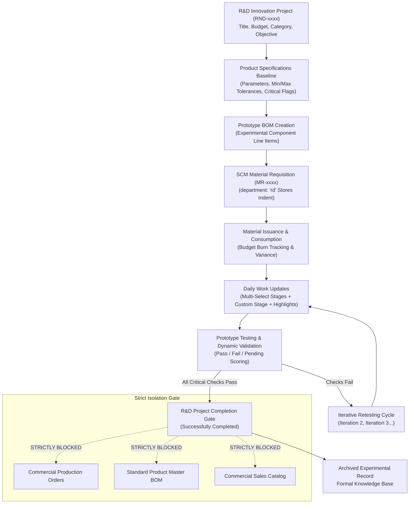

# CRYO Enterprise ERP 2.0 — Research & Development (R&D) Architecture & Workflow Specification

## 1. Executive Summary & Department Overview
The **Research & Development (R&D)** department (`/rd`, Violet Accent) in CRYO Enterprise ERP 2.0 provides an isolated, experimental engineering workspace for new product conceptualization, prototype prototyping, specification baselining, component testing, and validation.

R&D operates under an **Autonomous Experimental Paradigm**: innovation teams have the flexibility to requisition prototype raw materials from Supply Chain inventory, track financial budget burn rates, iterate through multiple testing cycles, and log daily fabrication progress without polluting or interrupting live commercial manufacturing schedules.



---

## 2. End-to-End R&D Innovation Lifecycle

### Phase 1: Innovation Project Initiation (`RND-xxxx`)
1. **Creation**: Project initiated by R&D managers via `POST /api/rd/projects`.
2. **Metadata**: Captures project title, category (`Ultra-Low Temp`, `Cryocoolers`, `Sensors & Instrumentation`, `Vacuum Systems`, `Custom Rig`), assigned lead engineer, allocated innovation budget, target completion date, and research objective.
3. **State Machine**:
   - `Planning` → `Active Prototyping` → `Testing & Validation` → `Review` → `Successfully Completed` or `Shelved`.

### Phase 2: Product Specifications Baseline
1. **Specification Definition**: Drafted via `POST /api/rd/projects/:id/specifications`.
2. **Quantitative Tolerances**: Itemizes engineering parameters with target values, permissible minimum and maximum tolerances, unit of measurement, test verification method, and critical classification (`isCritical: true`).
3. **Immutability & Versioning**: Serves as the immutable standard against which prototype test runs are measured.

### Phase 3: Prototype BOM & Supply Chain Requisition
1. **BOM Assembly**: Prototyping bill of materials compiled via `POST /api/rd/projects/:id/boms`.
2. **Flexible Sourcing**: Items can be sourced from `Stock`, `Procurement`, `Custom Fabrication`, or `Existing Rig`.
3. **SCM Store Indent Integration**:
   - Requisitioning triggers `POST /api/rd/projects/:id/requisitions`.
   - Automatically registers a formal Supply Chain Material Request (`MR-xxxx`) with `department: 'rd'`.
   - Supply Chain stores review and issue parts without requiring a commercial sales order or production order reference.
4. **Financial Burn Rate Tracking**:
   - Real-time aggregation of prototype costs against allocated budget (`burnRatePercent`).
   - Flags budget warnings if consumption exceeds 90% of allocated research funds.

### Phase 4: Daily Work Updates & Flexible Floor Logging
1. **Floor Progress**: Logged by engineers via `POST /api/rd/projects/:id/work-updates`.
2. **Multi-Select Stage Chips**: Supports selecting multiple active manufacturing stages simultaneously (e.g., `Design Review`, `Fabrication`, `Electrical Wiring`).
3. **Dynamic Custom Stage Addition**: Engineers can define new experimental stages on-the-fly (e.g., `Cryogenic Vacuum Pumping Test Stage`).
4. **Multi-Item Work Highlights**: Repeatable shift bullets capturing exact technical steps taken.

### Phase 5: Prototype Testing, Validation & Iterative Retests
1. **Test Execution**: Logged via `POST /api/rd/projects/:id/tests`.
2. **Dynamic Checkpoints**: Checklist containing parameters, expected baseline, measured values, observation remarks, and 3-way toggle state (`Pass`, `Fail`, `Pending`).
3. **Retesting Counter**: Automatically increments `iterationNumber` (`Iteration 1`, `Iteration 2`, `Iteration 3...`) allowing teams to document progressive improvements until target stability is achieved.

### Phase 6: Project Completion Gate & Knowledge Archiving
1. **Final Gate**: Formal authorization via `POST /api/rd/projects/:id/complete`.
2. **Outcome**: Marks project as `Successfully Completed` (or `Shelved` via review) and locks specifications and test records into the permanent knowledge base.

---

## 3. Strict Architectural Isolation Boundary

### Mandatory Isolation Rule
CRYO Enterprise ERP 2.0 enforces a **Strict Architectural Isolation Boundary** around the R&D department:

> **Project completion in R&D must NEVER:**
> 1. Automatically generate commercial Production Orders (`ProductionOrderModel`).
> 2. Automatically create or mutate standard Product Master BOMs (`BOMModel`).
> 3. Automatically inject items into the commercial Sales Product Catalog (`ProductModel`).

### Architectural Rationale
1. **Prevent Production Contamination**: Experimental designs and prototype component numbers are not verified for industrial volume manufacturing or commercial supply chain reliability.
2. **Controlled Engineering Transition (ECO)**: Moving a validated R&D prototype into commercial production requires a deliberate Engineering Change Order (ECO) and commercial executive sign-off.
3. **Cost & Accounting Integrity**: Prototype material costs are categorized as Research & Experimental Expenses, distinct from Cost of Goods Sold (COGS).

### Automated Verification Gate
In `backend/server/tests/rd-workflow.test.ts`, Test Scenario 6 verifies this boundary programmatically:
```typescript
const prodOrdersBefore = await ProductionOrderModel.countDocuments();
const bomsBefore = await BOMModel.countDocuments();
const productsBefore = await ProductModel.countDocuments();

await apiRequest(`/rd/projects/${rdProjectId}/complete`, { method: 'POST', token: adminToken });

assert.equal(await ProductionOrderModel.countDocuments(), prodOrdersBefore);
assert.equal(await BOMModel.countDocuments(), bomsBefore);
assert.equal(await ProductModel.countDocuments(), productsBefore);
```

---

## 4. Permission & RBAC Mapping

| Module Key | View | Create | Edit | Delete | Submit | Approve | Verify | Confirm | Export | Manage |
| :--- | :---: | :---: | :---: | :---: | :---: | :---: | :---: | :---: | :---: | :---: |
| `rd` | ✓ | ✓ | ✓ | ✓ | ✓ | ✓ | ✓ | ✓ | ✓ | ✓ |
| `rd_projects` | ✓ | ✓ | ✓ | ✓ | ✓ | ✓ | — | ✓ | ✓ | ✓ |
| `rd_specifications` | ✓ | ✓ | ✓ | ✓ | — | — | — | — | ✓ | ✓ |
| `rd_bom` | ✓ | ✓ | ✓ | ✓ | ✓ | — | — | — | ✓ | ✓ |
| `rd_work_updates` | ✓ | ✓ | ✓ | — | — | — | — | — | ✓ | ✓ |
| `rd_testing` | ✓ | ✓ | ✓ | — | ✓ | — | ✓ | ✓ | ✓ | ✓ |

---

## 5. Seed Users & Quick Access Credentials
- **Head of Cryogenic R&D**: `rd.mgr@cryoerp.com` / `password123` (Full R&D administration, budget oversight, completion authority).
- **Senior Prototype Engineer**: `rd.eng@cryoerp.com` / `password123` (Specifications, prototype BOM, daily floor updates, test execution).
