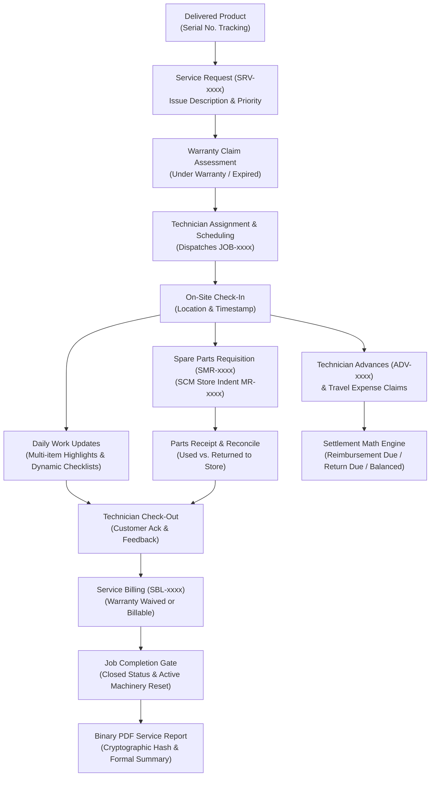

# CRYO Enterprise ERP 2.0 — Service Management Architecture & Workflow Specification

## 1. Executive Summary & Department Overview
The **Service Management** department (`/service`, Emerald Accent) in CRYO Enterprise ERP 2.0 extends the operational footprint of the enterprise beyond initial product delivery into complete after-sales support, on-site diagnostics, preventive maintenance, warranty claims administration, field engineering, and customer service billing.

The module connects customer-facing service requests with field service engineering, supply chain spare parts fulfillment, technician financial settlements, and formal binary PDF reporting.

---

## 2. Shared Delivered Products Register
The **Delivered Products Register** serves as the authoritative single source of truth for all machinery and equipment installed at customer facilities. It is bi-directionally accessible by both **Service Management** (`/service/delivered-products`) and **Production Management** (`/production/delivered-products`).

### Data Model & Warranty Calculation
Each delivered product record contains:
- `serialNumber`: Unique manufacturer serial number (e.g., `CRYO-CLP-2026-0814`).
- `productName` & `modelNumber`: Product identification from master catalog.
- `customerId` & `customerName`: Owning customer entity.
- `deliveryAddress`: Physical installation address of the unit.
- `deliveryDate`: Date delivery was completed and accepted.
- `deliveryOrderDocNo`: Linked logistics delivery order (`DEL-xxxx`).
- `salesOrderDocNo`: Originating commercial sales order (`SO-xxxx`).
- `warrantyExpiryDate`: Computed warranty end date.
- `warrantyStatus`: Dynamically derived or persisted status:
  - `Under Warranty`: Current date is before or equal to warranty expiry date.
  - `Expired`: Current date is strictly after warranty expiry date.
  - `Not Configured`: No warranty period assigned to the delivered unit.
- `status`: Machine health status (`Active`, `Under Service`, `Decommissioned`).
- `serviceHistory`: Array of completed or in-progress service job IDs and dates.

### Automated Delivery Synchronization
When a Logistics delivery order (`DEL-xxxx`) is marked as `Delivered` in the logistics module, the system automatically registers all included serial numbers into `DeliveredProductModel`, setting the delivery date and deriving the warranty expiry date (default 12 months for standard cryogenic systems).

---

## 3. End-to-End Service Lifecycle Workflows

### Phase 1: Service Request Initiation & Triage (`SRV-xxxx`)
1. **Creation**: Logged by customer support, service coordinators, or sales reps via `POST /api/service/requests`.
2. **Identification**: Captures customer, delivered machinery serial number (or manual input if historical legacy unit), service type (`Customer Site` vs `CRYO Workshop`), and urgency priority (`Low`, `Medium`, `High`, `Urgent`).
3. **Initial State**: Created in `Open` status. If linked to an active delivered product, the product's status transitions to `Under Service`.

### Phase 2: Warranty Claim Assessment
1. **Automated Verification**: The system evaluates `DeliveredProduct.warrantyStatus`.
2. **Coordinator Verification**: Service coordinator reviews claim validity via `PATCH /api/service/requests/:id/warranty-check`.
3. **Claim Gate**:
   - `Under Warranty`: Spare parts and labor are flagged as complimentary (`isWarrantyCovered: true`).
   - `Expired` or Out-of-Scope: Flagged as chargeable (`isChargeable: true`), requiring customer billing authorization.

### Phase 3: Technician Assignment & Job Dispatch (`JOB-xxxx`)
1. **Scheduling**: Coordinator assigns an eligible service technician (`emp-9` / field engineer) and schedules the visit date via `POST /api/service/requests/:id/assign`.
2. **Job Generation**: Automatically spawns a linked `ServiceJob` record (`JOB-xxxx`) in `Scheduled` status.
3. **Technician Agenda**: Appears instantly on the technician's mobile agenda (`/service/schedule` and `/service/jobs?myJobs=true`).

### Phase 4: Technician On-Site Check-In
1. **Execution**: Field engineer checks in upon arriving at the customer site via `POST /api/service/jobs/:id/check-in`.
2. **Capture**: Records precise ISO timestamp, GPS/site location (`Apex Biotech Lab 3`), and preliminary remarks.
3. **State Transition**: Both the `ServiceJob` and linked `ServiceRequest` transition to `In Progress`.

### Phase 5: Daily Work Updates & Dynamic Inspection Checklists
1. **Execution**: Engineer records daily diagnostic and repair logs via `POST /api/service/jobs/:id/work-updates`.
2. **Multi-Point Checklist**: Dynamic array of test checks with 3-way toggle states (`Pass`, `Fail`, `Pending`), measured values, and observation notes (e.g., Supply Voltage, Vacuum Insulation, PT100 Resistance).
3. **Work Highlights**: Repeatable shift highlights capturing exact actions taken (e.g., "Replaced PT100 thermocouple probe lead").
4. **Hours Tracking**: Automatically accumulates `totalHoursSpent` on the parent `ServiceJob`.

### Phase 6: Spare Parts Requisition & Supply Chain Integration (`SMR-xxxx`)
1. **Indenting**: If replacement parts are required, technician submits a Service Material Request via `POST /api/service/jobs/:id/material-requests`.
2. **SCM Bridging**: The backend immediately spawns a corresponding Supply Chain Material Request (`MR-xxxx`) tagged with `department: 'service'`.
3. **Stores Issuance**: Supply Chain storekeeper reviews stock in `/supply-chain/material-requests` and issues the required components.
4. **Physical Receipt**: Technician acknowledges receipt on-site via `PATCH /api/service/material-requests/:id/receive`, returning the job from `Awaiting Spares` back to `In Progress`.
5. **Reconciliation Gate**: At job conclusion, technician reconciles used vs. returned parts via `POST /api/service/material-requests/:id/reconcile`. Unused components are returned to central store inventory.

### Phase 7: Technician Advances & Expense Claims Settlement
1. **Advance Disbursal**: Company disburses travel advances via `POST /api/service/advances` (`ADV-xxxx`, e.g., ₹10,000 for travel and lodging).
2. **Expense Logging**: Technician logs actual expenses with receipt attachments and payment mode (`Paid by Technician` vs `Paid by Company`) via `POST /api/service/expenses`.
3. **Manager Verification**: Service manager verifies claims via `PATCH /api/service/expenses/:id/verify`.
4. **Deterministic Settlement Math**:
   - `totalExpenses = employeePaid + companyPaid`
   - `reimbursementDue = Math.max(0, employeePaid - advancePaid)`
   - `advanceToReturn = Math.max(0, advancePaid - employeePaid)`
   - Status: `Reimbursement Due`, `Advance Return Due`, or `Balanced`.
5. **Final Settlement**: Closed out via `POST /api/service/expenses/settle`.

### Phase 8: Check-Out, Customer Billing & Completion Gate
1. **Check-Out**: Technician logs resolution summary, customer representative name, and signature acknowledgement via `POST /api/service/jobs/:id/check-out`. Transitions job to `Work Completed`.
2. **Customer Billing (`SBL-xxxx`)**:
   - Generated via `POST /api/service/jobs/:id/billing`.
   - Items covered under warranty are billed at ₹0 with `isWarrantyCovered: true`.
   - Non-warranty spare parts and labor rates are computed with GST.
   - Status defaults to `Waived` for 100% warranty coverage or `Pending` for chargeable jobs.
3. **Completion Gate**: Final authorization via `POST /api/service/jobs/:id/complete` transitions Job to `Closed`, Service Request to `Completed`, and resets the Delivered Product status to `Active`.
4. **Binary PDF Service Report**: Generated on-demand via `GET /documents/service-report/:jobId/pdf` featuring customer information, machine serial numbers, check-in/out timestamps, checklist test results, parts consumed, technician details, and customer sign-off.

---

## 4. Permission & RBAC Mapping
Service Management integrates natively with CRYO ERP 2.0 Universal RBAC:

| Module Key | View | Create | Edit | Delete | Submit | Approve | Verify | Confirm | Export | Manage |
| :--- | :---: | :---: | :---: | :---: | :---: | :---: | :---: | :---: | :---: | :---: |
| `service` | ✓ | ✓ | ✓ | ✓ | ✓ | ✓ | ✓ | ✓ | ✓ | ✓ |
| `delivered_products` | ✓ | ✓ | ✓ | — | — | — | — | — | ✓ | ✓ |
| `service_requests` | ✓ | ✓ | ✓ | ✓ | ✓ | ✓ | — | — | ✓ | ✓ |
| `service_jobs` | ✓ | ✓ | ✓ | — | ✓ | — | — | ✓ | ✓ | ✓ |
| `service_materials` | ✓ | ✓ | ✓ | — | ✓ | — | — | ✓ | ✓ | ✓ |
| `service_expenses` | ✓ | ✓ | ✓ | — | ✓ | ✓ | ✓ | ✓ | ✓ | ✓ |
| `service_billing` | ✓ | ✓ | ✓ | — | ✓ | ✓ | — | ✓ | ✓ | ✓ |

---

## 5. Seed Users & Quick Access Credentials
- **Service Operations Manager**: `service.mgr@cryoerp.com` / `password123` (Full service administrative & settlement authority).
- **Service Field Engineer**: `tech.anil@cryoerp.com` / `password123` (Site visits, mobile check-in/out, work logs, expenses).
