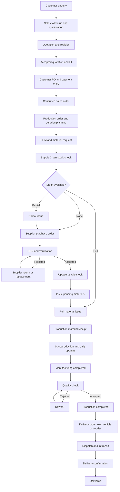
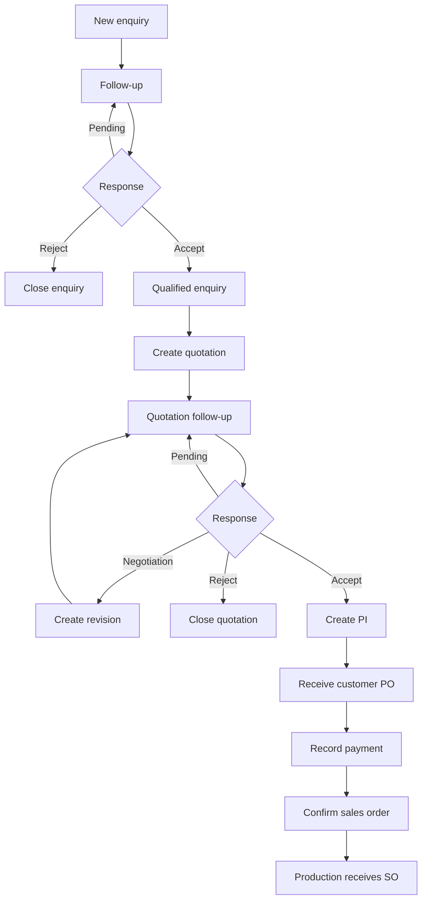
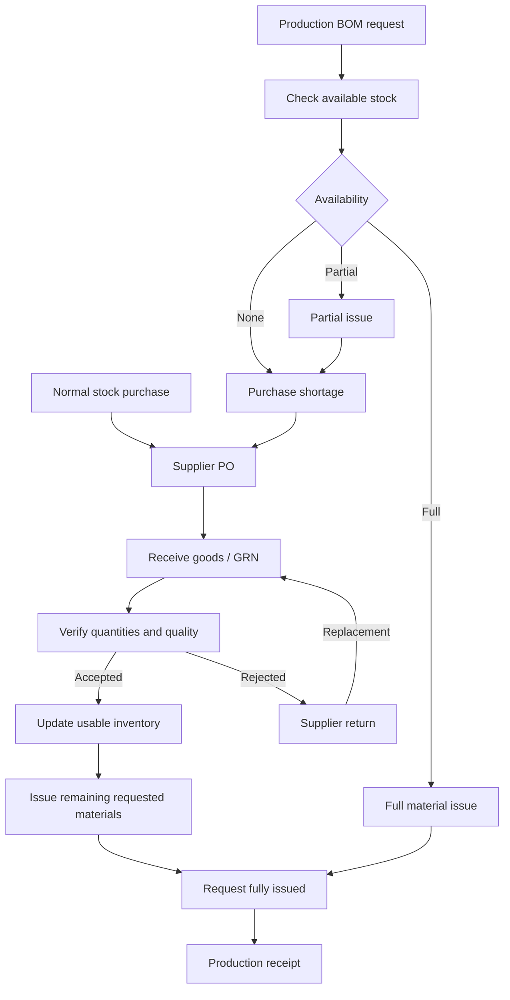
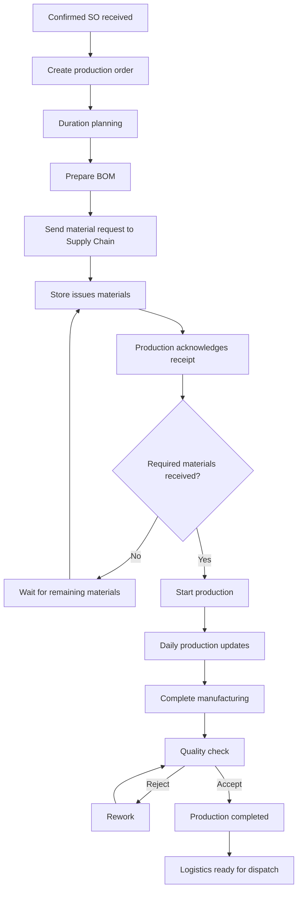
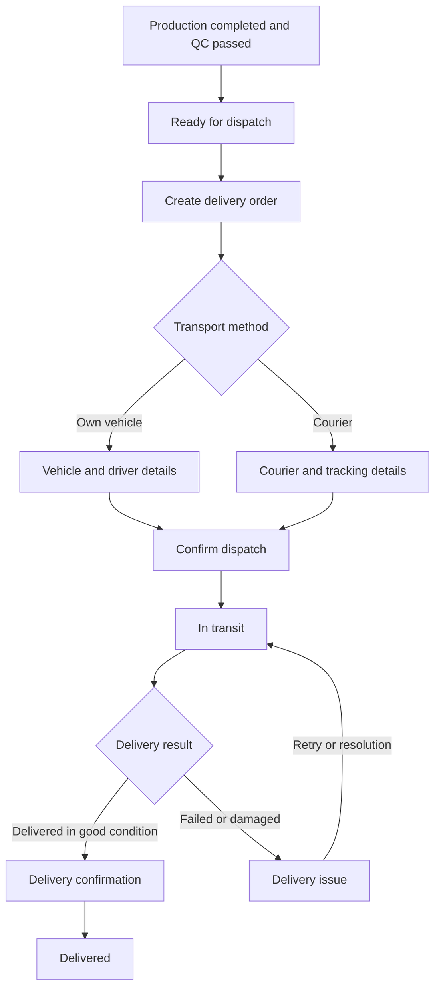
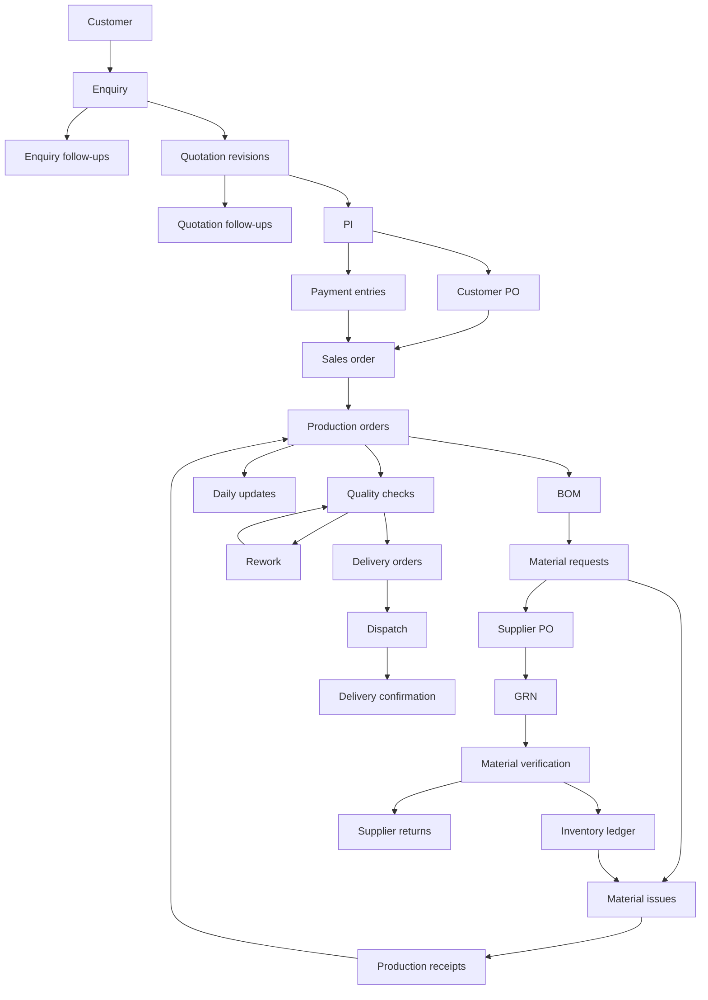

# CRYO Enterprise ERP 2.0 — Complete Workflow Specification

**Scope:** Sales Management, Supply Chain Management, Production Management, Logistics & Delivery Management.

**Purpose:** A single reference for building the application in Google AI Studio and implementing or refining it in Antigravity. This is a proposed business specification based on the requested workflow, not a verified description of the existing source code. Examples are illustrative; actual product specifications, commercial terms and approval policies must be confirmed with CRYO.

## 1. Application principles

- Keep the application simple, department-wise and user-friendly. Use a single workspace per department, not separate executive and manager screens.
- Enter customer and product details once; reuse linked records throughout the workflow.
- Every document has a unique ID, status, creation date, responsible employee, and links to its source documents.
- Every list has search, meaningful status filters, basic sorting, and a detail page. Show relevant actions only.
- Use simple forms, conditional fields, automatic totals, optional notes and attachments. Hide irrelevant department information.
- Admin, employees, roles, permissions, notifications and company settings are shared supporting modules, not additional operational departments.
- Enforce permissions, validations, duplicate prevention and stock consistency on the backend, not only in the UI.
- Maintain a root-level `project.md`: read it before changes; update it after changes with implementation decisions, affected files, tests, known issues and pending tasks.

## 2. End-to-end workflow

Payment tracking remains separate from fulfillment; an order can be delivered with an outstanding balance if permitted by its agreed terms.

# 3. Department 1 — Sales Management

## 3.1 Objective and navigation

Convert customer enquiries into confirmed sales orders, preserving all follow-ups and quotation revisions.

| Screen | Purpose |
|---|---|
| Dashboard | New enquiries, qualified enquiries, pending quotations, today's/overdue follow-ups, confirmed orders, pending payments |
| Enquiries | Create and track enquiries |
| Qualified Enquiries | Accepted/qualified enquiries ready for quotation |
| Follow-ups | Scheduled and historical enquiry and quotation follow-ups |
| Customers | Customer master and linked transaction history |
| Products | Saleable product catalogue |
| Quotations | Create, send, revise and accept quotations |
| Proforma Invoices | Generate PI from accepted quotation |
| Customer Purchase Orders | Record PO received from customer |
| Payment Entries | Record customer payments |
| Sales Orders | Confirm and track fulfillment |

## 3.2 Customer master

| Field | Description |
|---|---|
| Customer / company name | Required |
| Contact person | Primary contact |
| Phone | Contact number |
| Email | Contact email |
| Billing address | Invoice address |
| Shipping address | Delivery address |
| GSTIN | If applicable |
| Notes | Optional |

Customer detail tabs: Overview, Enquiries, Quotations, Orders, Payments. Allow selecting an existing customer or creating one inline during enquiry entry. Avoid duplicate customer records; warn on matching identifiers.

## 3.3 Product master

| Field | Description |
|---|---|
| Product name, product code | Unique catalogue identity |
| Category, model | Product classification |
| Specifications | Technical description |
| Product highlights | Reusable feature list |
| Selling price, unit | Default commercial values |
| Image, description | Optional |
| Status | Active / Inactive |

Example: ULT Freezer, model ULT-500, -80°C, 500L. These are illustrative, not confirmed engineering specifications. Keep saleable products separate from raw-material master.

## 3.4 Enquiry creation

**Customer fields:** Existing/new customer, company name, contact person, phone, email, address, enquiry source (phone/email/website/direct).

**Product fields:** Product, model, quantity, required specifications, customer requirements, expected delivery date, optional notes. Support multiple product lines where required.

Auto-generate an enquiry ID such as `ENQ-001`; assign the responsible employee. Actions: Save, View, Edit, Add Follow-up, Qualify, Reject.

Statuses: New → Contacted → Qualified / Rejected; Pending or On Hold when appropriate. Reject requires a reason. Qualification means the enquiry is ready for quotation, not that a sales order has been accepted. Qualified enquiries are a filtered view of the same records, not duplicates.

## 3.5 Enquiry follow-up

| Field | Description |
|---|---|
| Enquiry reference | Automatically linked |
| Customer / product summary | Auto-filled, read-only |
| Follow-up date | Date/time of contact |
| Contact method | Call / Email / Meeting |
| Discussion details | Conversation and requirements |
| Next follow-up date | If another contact is needed |
| Response | Pending / Accept / Reject |
| Followed by | Logged-in employee |
| Rejection reason | Required if rejected |

Store every follow-up as a separate historical record. Show a chronological timeline on the enquiry detail page and a central follow-up list with upcoming, today, overdue and completed filters. On acceptance, automatically qualify the enquiry. On rejection, close it and cancel unnecessary future reminders.

## 3.6 Quotation creation

Create quotation from qualified enquiry; automatically fetch customer and product details.

| Section | Fields |
|---|---|
| Header | Quotation ID, date, validity, enquiry reference |
| Customer | Name, contact, billing/shipping addresses |
| Product rows | Product, model, specifications, quantity, unit price |
| Highlights | Multiple editable feature points per product |
| Pricing | Discounts, tax/GST, subtotal, grand total |
| Terms | Payment terms, delivery terms, warranty |
| Other | Remarks, attachments |

Calculate totals on the backend. Allow Save Draft, Generate PDF, Send/Mark Sent, Add Follow-up, Revise, Accept and Reject. Preserve document snapshots for historical accuracy.

## 3.7 Quotation follow-up and negotiation

Follow-up fields: quotation/version reference, date, method, discussion, next follow-up date, response (Pending / Accepted / Rejected / Negotiation), employee and optional attachments. Rejection requires a reason.

Negotiation creates a new revision copied from the previous version, allowing price, quantity, specification, highlights or terms changes. Preserve earlier versions and their follow-ups. Only one current accepted version may be used to generate a PI.

| Example version | Amount | Status |
|---|---:|---|
| QT-001-V1 | ₹5,00,000 | Superseded |
| QT-001-V2 | ₹4,80,000 | Superseded |
| QT-001-V3 | ₹4,70,000 | Accepted |

Statuses: Draft, Sent, Pending, Negotiation, Superseded, Accepted, Rejected, Expired. Do not overwrite a sent/accepted historical version. Acceptance is a recorded action with employee/date.

## 3.8 Proforma Invoice (PI)

Create PI only from the accepted quotation version. Fields: auto-generated PI number/date, accepted quotation reference, customer and product details, quantities, commercial totals, payment terms, bank details from company settings, remarks. Generate PDF, print and share. A PI is not a final tax invoice.

## 3.9 Receive customer purchase order (CPO)

This is a PO received from the customer, distinct from a supplier PO.

Simple form: linked PI, customer PO number, PO received date, expected delivery date, PO document attachment, optional remarks. Customer, products, quantities and price are auto-filled from the PI. If the received PO differs materially, record and resolve differences before confirming SO. Do not silently overwrite accepted terms.

## 3.10 Payment entry

Simple form: PI/SO reference, customer (auto-filled), payment amount, date, method (bank/UPI/cheque/cash as applicable), transaction reference, optional proof and remarks. Record multiple payments against the same order. Verification status where required: Pending / Verified / Rejected.

Example: order ₹5,00,000; verified receipts ₹2,00,000; outstanding ₹3,00,000. Calculate balance from posted/verified payments, not manually entered totals. Prevent duplicate payment references where applicable. Handle corrections through controlled reversals. SO confirmation depends on agreed advance/payment terms, not necessarily full payment.

## 3.11 Sales order (SO)

Create from accepted quotation, PI, recorded customer PO and required payment confirmation. Fields: SO number, customer, product lines, quantity, accepted technical specifications and highlights, final amounts and terms, PI/CPO/payment references, delivery address/date, priority (Normal/High/Urgent), optional remarks.

On confirmation, automatically make the SO visible in Production's Received Sales Orders. Prevent duplicate conversion or production allocations exceeding ordered quantities. Sales order detail page: Overview, Documents, Payments, Production, Delivery, History. Keep commercial status, payment status and fulfillment status separate.

# 4. Department 2 — Supply Chain Management

## 4.1 Objective and navigation

Receive BOM requests, check stock, issue available materials partially or fully, purchase shortages or normal stock, receive goods, verify materials, return rejected items and update inventory.

| Screen | Purpose |
|---|---|
| Dashboard | Pending requests, shortages, low stock, open POs, pending GRNs/verification |
| Material Requests | BOM requests from production |
| Materials | Raw material master |
| Inventory / Stock | Usable, reserved and available quantities |
| Suppliers | Supplier master |
| Purchase Orders | Request-based and normal supplier purchases |
| GRN | Goods receipt against supplier PO |
| Material Verification | Incoming inspection |
| Supplier Returns | Rejected materials and replacements |
| Material Issues | Full and partial issues |
| Stock History | Material transaction ledger |

## 4.2 Material and supplier masters

Material fields: unique code, name, category, specification, unit of measure, minimum stock, storage location, preferred supplier, active status. Inventory balance is derived from stock transactions, not freely editable master data.

Supplier fields: company name, contact person, phone, email, address, GSTIN if applicable, supplied materials, optional notes, active status.

## 4.3 Material request received

Automatically receive submitted BOM requests linked to production order, SO and product. Show required, previously issued, pending, usable/available stock and shortage per material. Show request date, priority and requested-by employee.

| Example material | Required | Available | Shortage |
|---|---:|---:|---:|
| Compressor | 4 | 2 | 2 |
| Controller | 2 | 2 | 0 |
| Sensor | 6 | 0 | 6 |
| Cooling fan | 4 | 4 | 0 |

Actions: Issue Available, Purchase Shortage, View Production Order. Allow multiple material issue transactions against one request.

## 4.4 Full and partial material issue

Form: material request reference, issue date, material lines, available quantity (read-only), issuing quantity, issued by, optional remarks. Issue quantities cannot exceed both available stock and outstanding requested quantity.

Example: requested 10, available 6 → issue 6, pending 4, remaining stock 0. When stock replenishes, issue the remaining 4 against the original request.

Statuses: Pending → Partially Issued → Fully Issued. Track physical receipt separately: Pending Receipt / Partially Received / Fully Received. Posting an issue reduces store stock once; acknowledging receipt does not reduce it again. Use atomic transactions and idempotency to prevent overselling, negative stock or duplicate deduction.

## 4.5 Supplier purchase order

Support two purchase types: **Request-based** (material shortages linked to original requests) and **Normal purchase** (direct stock replenishment without a production request).

Fields: supplier PO number/date, supplier selection, purchase type, optional material request references, expected delivery date, material rows (quantity, unit, unit price, tax), totals, optional terms/remarks. Request-based purchases should prefill uncovered shortages and avoid duplicate purchasing against quantities already on open POs.

Statuses: Draft → Ordered → Partially Received → Received → Closed; Cancelled where applicable. Track ordered, received, accepted, rejected, returned and outstanding quantities independently.

## 4.6 Goods Receipt Note (GRN)

Create GRN when supplier goods arrive. Fields: GRN ID, supplier PO reference, supplier (auto-filled), receipt date, supplier invoice/DC reference, material lines, ordered quantity, previously received, current received quantity, attachments and remarks. Support multiple GRNs for partial deliveries. Prevent excess receipt unless explicitly authorized.

Unverified goods are not available for issue. GRN status: Pending Verification / Verified / Partially Accepted / Rejected.

## 4.7 Material verification

Form: GRN reference, inspection date, verifier, received quantities, accepted quantities, rejected quantities, reason for rejection, optional photos/documents and remarks. Accepted + rejected quantities must equal inspected quantity; uninspected quantity remains pending.

| Example | Received | Accepted | Rejected |
|---|---:|---:|---:|
| Compressor | 5 | 4 | 1 |
| Sensor | 10 | 10 | 0 |
| Controller | 3 | 2 | 1 |

Only accepted quantities enter usable stock. Rejected items remain segregated and eligible for supplier return. Post accepted stock once per verified line.

## 4.8 Supplier return and replacement

Form: GRN and verification reference, supplier, rejected material, return quantity, reason, return date, replacement required (yes/no), optional document and remarks. Return quantities cannot exceed eligible rejected quantities. For rejected incoming stock already excluded from usable inventory, do not deduct usable stock again. Replacement arrivals require a new GRN/verification linked to the original PO/return. Track pending replacement or supplier credit/closure as appropriate.

## 4.9 Inventory ledger and stock updates

| Event | Effect on usable stock |
|---|---|
| Verified accepted GRN | Increase |
| Finalized material issue | Decrease |
| Production receipt acknowledgement | No second store deduction |
| Unused production material return accepted by store | Increase |
| Rejected incoming material return | No change to usable stock |
| Authorized stock adjustment | Increase/decrease with reason |

Available stock = usable on-hand minus reserved stock, if reservation is implemented. Maintain material, quantity, unit, transaction type, linked document, date/time, employee, and resulting balance. Notify Production when outstanding material requests are issued; do not automatically mark them physically received unless that is the agreed business policy.

# 5. Department 3 — Production Management

## 5.1 Objective and navigation

Receive confirmed SOs, create production orders, plan duration, prepare BOM, request and receive materials, manufacture, record daily work, perform quality inspection, rework rejected products and release accepted products to Logistics.

| Screen | Purpose |
|---|---|
| Dashboard | Received SOs, planned orders, material shortages, active production, QC pending, rework, completed orders |
| Received Sales Orders | Confirmed sales orders awaiting production allocation |
| Production Orders | All linked production orders |
| Production Planning | Start/end dates, duration and assignments |
| BOM & Material Requests | Prepare BOM and track material requests |
| Material Receipts | Acknowledge materials issued by store |
| Active Production | Started manufacturing orders |
| Daily Production Updates | Record and view progress |
| Quality Check | Inspect manufactured products |
| Rework | Correct rejected products |
| Completed Production | QC-passed products and history |

## 5.2 Received sales orders and production order

Show confirmed SO ID, customer, product/model, accepted specifications and highlights, ordered quantity, remaining quantity to allocate, promised delivery date and priority. Action: Create Production Order. Do not recreate the sales order itself. Support separate production orders for product lines or batches if necessary, without exceeding the confirmed order quantity.

| Form field | Description |
|---|---|
| Production order ID | Auto-generated, e.g. PROD-001 |
| SO reference and product line | Automatically linked |
| Customer, product, accepted specification | Auto-filled |
| Production quantity | Within remaining SO quantity |
| Planned start/end date | Duration planning |
| Planned duration | Calculated using defined calendar-day or working-day convention |
| Production in-charge | Select employee |
| Assigned employees | If applicable |
| Priority | Normal / High / Urgent |
| Instructions | Optional manufacturing notes |

Validate end date is not before start date. Warn if plan exceeds customer delivery commitment. Record actual start/end dates separately from planned dates.

## 5.3 BOM preparation and material request

Use a reusable product-specific BOM template where available, or prepare a custom BOM based on the accepted order specifications. Fields: production order reference, product/model, production quantity, material lines, quantity per product, unit, total required quantity, optional notes. Total required = per-product quantity × production quantity (plus separately approved allowance if applicable).

| Example material | Per product | Total for 2 products |
|---|---:|---:|
| Compressor | 2 | 4 |
| Controller | 1 | 2 |
| Cooling fan | 2 | 4 |
| Sensor | 3 | 6 |
| Steel sheets | 5 | 10 |

These quantities are illustrative only. Actions: Add Material, Save BOM, Send Request to Supply Chain. On submission create a linked material request. Preserve BOM revisions; changes after issue must reconcile quantities and avoid issuing duplicates.

## 5.4 Material receipt from store

Show per material: required, cumulative issued, pending issue, cumulative received and pending receipt. Display issue records and dates. Production acknowledges physical receipt against specific issue records, including discrepancies if any. Receipt quantities cannot exceed issued quantities not yet acknowledged.

Status synchronization: when Supply Chain issues materials, Production automatically sees the updated status; no duplicate issue entry. Material request fulfillment is derived from issued quantities; production readiness is derived from received quantities. A partially fulfilled request remains open. When all required materials are received, enable Start Production. Starting with partial materials is not the default; if required later, define explicit stage-level material readiness rules.

## 5.5 Start production and daily updates

Start Production records actual start timestamp, employee and order status In Progress. Manufacturing stages can be configured per product (for example preparation, fabrication, mechanical assembly, electrical assembly, cooling assembly, final assembly). Do not hardcode engineering stages as universal.

Daily update form:

| Field | Description |
|---|---|
| Production order | Required linked order |
| Customer, product, quantity, SO, planned dates | Automatically shown after selecting order |
| Work date | Date |
| Process/stage | Select relevant manufacturing stage |
| Work completed today | Description |
| Quantity completed | If measurable |
| Work hours | Optional duration |
| Process status | Pending / In Progress / Completed / Blocked |
| Employee | Logged-in employee or authorized assignment |
| Issues / remarks | Optional |
| Photos / attachments | Optional |

All updates appear chronologically on the order detail page. Calculate progress from agreed stages or completed quantities, not arbitrary percentages. Prevent double-counting cumulative quantity updates. Show blocked reasons and delayed orders on dashboard.

## 5.6 Production order detail page

Click a production order to see its full linked information in one page. Tabs:

- **Overview:** SO/customer/product/quantity, accepted specifications, planned and actual dates, assignments, current status and progress.
- **Materials:** BOM, material requests, issued and received quantities, shortages, related stock issue references.
- **Daily Work:** All dated work updates, stages, employees, notes and attachments; Add Update action.
- **QC:** Inspection attempts, results, accepted/rejected quantities, serial numbers, reports and rework references.
- **History:** Status transitions, employee, date/time and source documents.

Show the appropriate next action based on state: Prepare BOM, Request Materials, Acknowledge Receipt, Start Production, Add Update, Complete Manufacturing, Quality Check or Rework. Avoid unrelated controls.

## 5.7 Complete manufacturing

Form/action: actual manufacturing completion date, completed quantity, relevant serial numbers and final remarks. Do not exceed allocated production quantity. After submission move to QC Pending. Manufacturing completed is not the same as QC accepted or ready for delivery.

## 5.8 Quality check

| Field | Description |
|---|---|
| Production order and product | Auto-linked |
| Inspection date / inspector | Date and employee |
| Serial number / inspected quantity | Product identity |
| Checklist | Product-specific tests, result and observations |
| Example tests | Visual, electrical, temperature, performance and safety as applicable |
| Final result | Accept / Reject |
| Rejection reason | Required for failure |
| Report / photos / remarks | Optional supporting details |

Track accepted/rejected units individually or by quantity. Prevent duplicate acceptance. Preserve every inspection attempt. Accepted units are eligible for logistics release; the entire production order is Completed only when all required units are accepted (or an authorized quantity reduction is recorded). The default workflow releases a completed order; partial release may be enabled only if agreed with the client.

## 5.9 Rework

On QC rejection, create linked rework record with failed inspection reference, affected units/serial numbers, rejection reason, required correction, assignee, planned completion, completed work, actual completion and remarks. Status: Open → In Progress → Completed → Reinspection. After rework return to QC, never bypass inspection. Repeated rejection creates another traceable attempt.

## 5.10 Production completion

When required units pass QC, mark production completed. Record accepted quantity, serial numbers, actual completion date, final QC reference and responsible employee. Automatically make accepted units visible in Logistics Ready for Dispatch. Prevent duplicate release.

# 6. Department 4 — Logistics & Delivery Management

## 6.1 Objective and navigation

Handle completed and QC-passed products, arrange own vehicle or courier transport, dispatch and confirm delivery with simple forms.

| Screen | Purpose |
|---|---|
| Dashboard | Ready for dispatch, planned deliveries, in transit, delayed and delivered |
| Ready for Dispatch | QC-approved production output |
| Delivery Orders | Plan and manage deliveries |
| Dispatched / In Transit | Track dispatched shipments |
| Completed Deliveries | Delivered orders and proofs |
| Delivery Issues | Failed, damaged or delayed deliveries |
| Delivery History | All delivery records |

## 6.2 Ready for dispatch

Auto-fetch SO and production order references, customer, product/model, QC-approved quantity, available-to-dispatch quantity, serial numbers, delivery address, promised delivery date and QC status. Action: Create Delivery Order. Never allow dispatch of rejected or unapproved units.

## 6.3 Create delivery order

Common fields: delivery order ID, SO/production references, customer and shipping address (auto-filled), product and quantity, serial numbers if applicable, transportation method, planned dispatch date, expected delivery date, optional remarks.

| Own vehicle fields | Courier fields |
|---|---|
| Vehicle number | Courier company |
| Driver name | Tracking/AWB number (required at dispatch if not yet assigned) |
| Driver phone | Courier contact number (optional) |

Show only fields relevant to the selected method. Allow planned and actual transport dates separately. Support multiple shipments if needed, with cumulative quantity validation. Do not allocate or dispatch more than the available QC-approved quantity.

## 6.4 Confirm dispatch

Fields: delivery order reference, actual dispatch date/time, dispatched quantity, serial numbers, delivery challan number, transportation details, optional attachment and remarks. Status becomes Dispatched / In Transit. Automatically update linked SO fulfillment status and notify Sales. Preserve tracking number and dispatch history.

## 6.5 Confirm delivery

| Field | Description |
|---|---|
| Delivery order reference | Auto-linked |
| Actual delivery date/time | Date/time |
| Received by | Customer receiver name |
| Delivered quantity | Confirm quantity |
| Delivery condition | Good / Damaged |
| Proof of delivery | Signed document or photo, per agreed policy |
| Remarks | Optional |

Only successful delivered quantities count toward completed fulfillment. If delivery is damaged or failed, capture issue and resolution before marking affected units successfully delivered. Support partial delivery where required. When all ordered quantities have been delivered successfully, update SO fulfillment to Delivered. Outstanding payments remain visible separately.

## 6.6 Delivery issues

Record delivery reference, issue type (failed attempt, delay, damage, shortage), affected quantity, reason, date, responsible employee, corrective action, next attempt date and resolution. Preserve original dispatch and attempt history. Returned goods, replacements and stock effects require explicit linked transactions rather than silent quantity changes.

# 7. Shared workflows and integration

## 7.1 Interdepartmental handoffs

| Trigger | Source | Destination / automatic effect |
|---|---|---|
| Confirm SO | Sales | Received Sales Orders in Production |
| Submit BOM request | Production | Material Requests in Supply Chain |
| Post partial/full issue | Supply Chain | Production material issue status |
| Acknowledge receipt | Production | Linked receipt status; readiness recalculated |
| Verify accepted GRN | Supply Chain | Usable inventory increases; shortages recalculated |
| Complete manufacturing | Production | QC queue |
| Reject QC | Production QC | Rework queue |
| Accept QC and complete production | Production QC | Logistics Ready for Dispatch |
| Confirm dispatch | Logistics | Sales fulfillment timeline |
| Confirm delivery | Logistics | Sales fulfillment timeline and delivered quantity |

## 7.2 Centralized order tracking

Every SO detail page should provide one timeline with links to enquiry, follow-ups, accepted quotation/version, PI, customer PO, payment entries, SO confirmation, production orders, BOM requests, material issues/receipts, daily production updates, QC/rework, delivery orders, dispatch and delivery confirmation. Display Pending / Active / Completed / Blocked states, timestamps, responsible employees and relevant quantities. Use canonical linked records instead of a manually edited duplicate status.

## 7.3 Suggested document relationships

Use unique document IDs and stable internal references. Suggested one-to-many relationships: enquiry to follow-ups/quotation revisions; PI to payments; SO to production/delivery orders; material request to issues; supplier PO to GRNs; production order to updates/QC/rework; delivery order to delivery attempts. Retain accepted commercial snapshots even if master data changes.

## 7.4 Status reference

| Record | Main states |
|---|---|
| Enquiry | New, Contacted, Qualified, On Hold, Rejected |
| Follow-up | Scheduled, Completed, Overdue, Cancelled |
| Quotation | Draft, Sent, Pending, Negotiation, Superseded, Accepted, Rejected, Expired |
| Payment | Pending, Verified/Posted, Rejected, Reversed |
| SO commercial | Draft, Confirmed, Cancelled, Closed |
| SO payment | Unpaid, Partial, Paid (derived) |
| SO fulfillment | Awaiting Production, In Production, QC Pending, Ready for Dispatch, In Transit, Partially Delivered, Delivered |
| Material request | Pending, Partially Issued, Fully Issued, Cancelled |
| Material receipt | Pending, Partially Received, Fully Received |
| Supplier PO | Draft, Ordered, Partially Received, Received, Closed, Cancelled |
| GRN verification | Pending, Partially Accepted, Accepted, Rejected |
| Production order | Planned, Awaiting Materials, Ready to Start, In Progress, QC Pending, Rework, Completed |
| QC attempt | Pending, Accepted, Rejected |
| Rework | Open, In Progress, Completed, Reinspection |
| Delivery | Planned, Dispatched, In Transit, Partially Delivered, Delivered, Issue, Cancelled |

These are proposed state names. Implement allowed transitions explicitly; do not permit arbitrary state changes. Cancellation after stock, payments or shipment requires controlled reversal or resolution.

# 8. Shared admin, permissions and UI rules

- Common login, employee management, role assignments, department access, action permissions, company settings, document numbering and audit history.
- Department staff see permitted workspaces and relevant data. Manager approvals, if required by CRYO, appear as actions within the same screens. Admin can view cross-department activity subject to configured permissions.
- Shared notification center: new SO, BOM request, material issues, pending follow-up, QC failure, ready-for-dispatch and delivery status. Avoid duplicate notifications.
- Desktop sidebar and mobile-friendly navigation; show only relevant department screens. Use clear labels, compact forms, responsive tables/cards, searchable selections, status indicators and contextual next-action buttons.
- List pages show essential fields only; advanced information belongs on detail pages. Provide loading, empty, success and error states. Confirm destructive actions.
- Audit actor, timestamp and change reason. Restrict direct edits to finalized documents. Use server-side access control and input validation; validate file uploads.
- Dashboard counts must come from actual linked records, not hardcoded sample values. Support filters by date/status/employee where relevant.

# 9. Acceptance tests and implementation checklist

| Scenario | Expected result |
|---|---|
| Enquiry gets several follow-ups | Every entry retained and linked to original enquiry |
| Enquiry accepted/rejected | Correct qualification or closure; no duplicate record |
| Quotation negotiated twice | All versions preserved; accepted version feeds PI |
| Customer PO differs from PI | Difference flagged and resolved before SO confirmation |
| Multiple payments | Balance updates from posted receipts; agreed terms govern SO |
| SO confirmed twice/retry | No duplicate production requirement |
| Production creates BOM | Supply Chain sees request with correct material totals |
| Stock partially available | Issue available quantity; remaining requirement stays open |
| Normal stock purchase | Supplier PO works without BOM reference |
| Supplier delivers partially | Multiple GRNs track cumulative receipts |
| GRN partially rejected | Only accepted goods increase usable stock; rejected goods can be returned |
| Replacement arrives | New GRN verification; no double stock posting |
| Material issue posted twice/retry | Stock deducted once; no negative balance |
| Production acknowledges receipt | Readiness updates; store stock not deducted again |
| Daily update saved | Appears under correct production order with full source details |
| QC fails | Rework created; rejected units cannot dispatch |
| Rework completes | Reinspection required; historical results retained |
| QC accepted | Eligible products appear in Logistics automatically |
| Own vehicle selected | Only vehicle/driver fields shown |
| Courier selected | Only courier/tracking fields shown |
| Delivery confirmed | Linked SO fulfillment updates; payment balance unchanged |
| Partial/damaged delivery | No premature full fulfillment; issue history retained |
| Unauthorized employee accesses action | Backend denies action |

## 10. Project tracking instructions

Before implementing or modifying any feature, read root-level `project.md`, review existing architecture and business decisions, and check for conflicts with this specification. Do not replace working functionality blindly. After every change, update `project.md` with date, feature, affected files, UI/API/state/routing/database changes, business logic, tests, known issues and pending work. Keep this workflow file as the business requirement reference; record actual implementation progress separately in `project.md`.

## 11. Final scope and assumptions

The four operational departments are Sales, Supply Chain, Production and Logistics & Delivery. Shared administration supports them without introducing unnecessary workflow steps. Installation, service, full accounting, payroll and other ERP modules are outside this requested workflow unless separately approved. Actual approval hierarchy, tax treatment, payment verification policy, product-specific QC tests, partial production release and delivery proof requirements should be confirmed with the client. This document specifies the desired application; it does not establish that these features already exist or have been tested in the current codebase.
